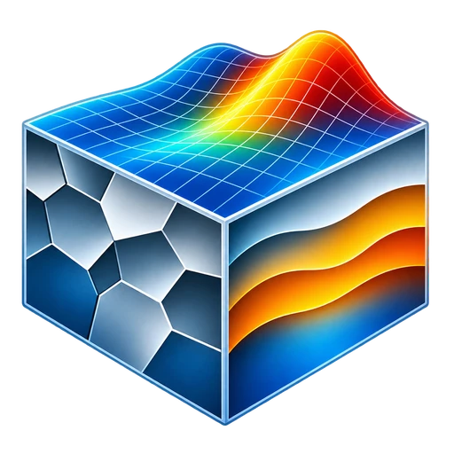
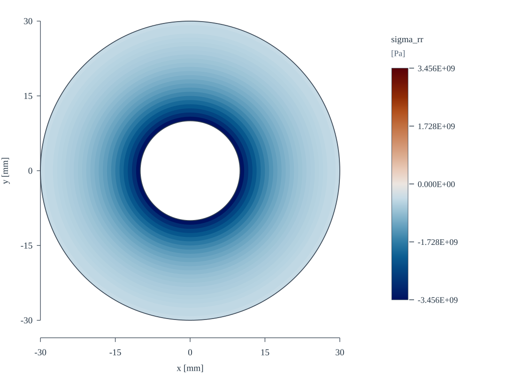
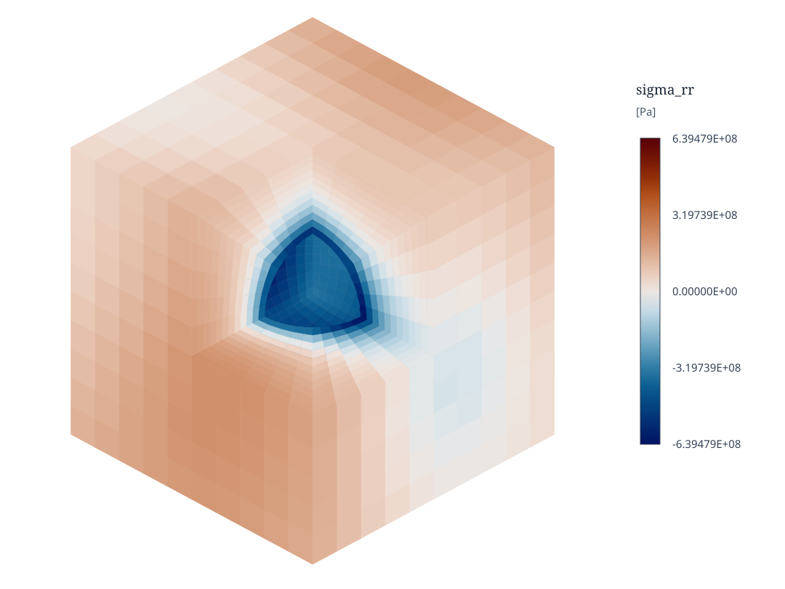

# ConstituF

<p align="center">
  
</p>

<p align="center">
  <a href="https://github.com/gha3mi/ConstituF/actions/workflows/ci.yml"></a>
  <a href="https://gha3mi.github.io/ConstituF/"></a>
  <a href="LICENSE"></a>
  <a href="https://fortran-lang.org/"></a>
  <a href="https://fpm.fortran-lang.org/"></a>
</p>

ConstituF is a Fortran library for evaluating constitutive laws at material
points. Its common batched interface provides physical responses, optional
consistent algorithmic tangents and analytical parameter sensitivities and
managed trial/committed history. It supports solid mechanics, transport,
electrical and coupled material models. The host solver remains responsible
for field equations, global assembly and nonlinear solution.

The numerical API is unitless. The caller chooses a consistent unit system
for parameters, fields, time increments and history. ConstituF returns values
in the corresponding derived units and does not store, check or convert unit
labels. Examples, tests and benchmarks state their chosen units for readers.

## Install

Add the library to an [fpm](https://fpm.fortran-lang.org/) project's
`fpm.toml`:

```toml
[dependencies]
constituf = { git = "https://github.com/gha3mi/ConstituF.git" }
```

For reproducible builds, pin a Git tag or exact commit. See
[working precision](https://gha3mi.github.io/ConstituF/page/precision.html)
before selecting a nondefault real kind.

## Evaluate one material point

This example chooses SI units: elastic moduli and stresses are in Pa and
strain is dimensionless. It evaluates three-dimensional isotropic elasticity
at a prescribed small strain:

```fortran
program elastic_point
    use constituf, only: wp, material_t, cf_ok
    use constituf_isotropic_elastic, only: isotropic_elastic_t
    implicit none (type, external)

    type(material_t) :: material
    real(wp) :: strain(6,1), stress(6,1)
    integer :: status

    call material%init(isotropic_elastic_t(160.0e9_wp,80.0e9_wp),1,status)
    if (status /= cf_ok) error stop "Initialization failed"

    strain = 0.0_wp
    strain(1,1) = 1.0e-3_wp
    call material%eval(strain,stress,status=status)
    if (status /= cf_ok) error stop "Evaluation failed"

    print '(a,es12.4)', "sigma_11 [Pa]: ",stress(1,1)
end program elastic_point
```

For this *uniaxial-strain* case, the expected axial stress is

$$
\sigma_{11}\approx2.667\times10^8\,\mathrm{Pa}.
$$

The arrays use `(component,point)` order. Symmetric three-dimensional
tensors use six Mandel components. The
[getting-started guide](https://gha3mi.github.io/ConstituF/page/getting-started.html)
adds a tangent, analytical parameter derivative and accepted-step
handling.

## Benchmarks

Isotropic elasticity is evaluated at prescribed strains on two sampling
geometries. The figures show radial Cauchy stress returned by ConstituF,
not solutions of the global equilibrium equations.

| 2D annulus | 3D spherical cavity |
| :---: | :---: |
|  |  |

These fixed previews accompany the [annulus](https://gha3mi.github.io/ConstituF/page/benchmark-annulus.html)
and [3D spherical-cavity](https://gha3mi.github.io/ConstituF/page/benchmark-cavity3d.html)
benchmark formulations, which describe the prescribed fields, response
measures and complete reproducible results.

## Documentation

| To | Read |
| --- | --- |
| Choose a constitutive law | [Materials catalog](https://gha3mi.github.io/ConstituF/page/index.html) and its linked FORD module references |
| Find the available operations | [Public interface](https://gha3mi.github.io/ConstituF/page/public-interface.html) |
| Run and understand examples | [Material examples](https://gha3mi.github.io/ConstituF/page/material-examples.html) |
| Integrate with an FEM code | [FEM integration](https://gha3mi.github.io/ConstituF/page/fem-integration.html) and [field conventions](https://gha3mi.github.io/ConstituF/page/conventions.html) |
| Use additional capabilities | [Checkpointing](https://gha3mi.github.io/ConstituF/page/checkpointing.html), [calibration](https://gha3mi.github.io/ConstituF/page/calibration.html), [working precision](https://gha3mi.github.io/ConstituF/page/precision.html) |
| Extend or check models | [Adding a material](https://gha3mi.github.io/ConstituF/page/adding-materials.html) and [verification](https://gha3mi.github.io/ConstituF/page/verification.html) |
| Reproduce scientific visualizations | [Benchmarks](https://gha3mi.github.io/ConstituF/page/benchmarks.html): annulus and three-dimensional spherical cavity |

The FORD module reference contains each model's governing equations,
parameter domains, field metadata, supported derivatives and limitations.

## Development commands

From a repository checkout with [Pixi](https://pixi.sh/) installed:

```console
pixi run lint
pixi run -e gnu test
pixi run -e gnu example
pixi run -e gnu benchmarks
pixi run docs
```

Replace `gnu` with `intel` for Intel ifx (Linux only). Run
`benchmarks` before `docs` to include generated benchmark results.

## License

[Apache-2.0](LICENSE).
